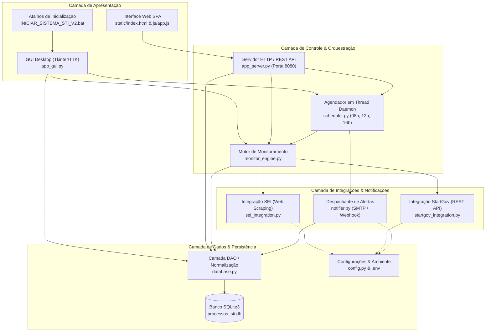

# Documentação Técnica e de Arquitetura de Desenvolvimento

**Sistema:** Sistema de Gestão e Monitoramento de Processos por Projeto - STI  
**Versão Atual:** v2.0  
**Data da Documentação:** Outubro/2026  
**Responsável Técnico:** Arquitetura de Software - STI / SEDUC-MA  

---

## 1. Visão Geral da Aplicação

O **Sistema de Gestão e Monitoramento de Processos por Projeto - STI** é uma solução corporativa concebida para a Superintendência de Tecnologia da Informação (STI) da Secretaria de Estado da Educação do Maranhão (SEDUC-MA). 

O sistema tem como objetivo centralizar o controle de projetos estratégicos de TI e automatizar o rastreamento contínuo de processos administrativos vinculados que tramitam em ecossistemas distintos:
* **SEI (Sistema Eletrônico de Informações - GOVMA)**: Tramitação de processos administrativos eletrônicos padrão do Governo Estadual.
* **STARTGOV (Portal de Gestão de Compras e Licitações)**: Tramitação de processos de contratação, cotação e termos de referência.

A aplicação opera tanto em modo **Desktop nativo (GUI)** quanto via **Servidor Web e API REST embutida**, possuindo um robô de raspagem (crawler/API client) e um agendador autônomo com envio programado de relatórios consolidados às **08:00, 12:00 e 16:00**.

---

## 2. Arquitetura de Software

A solução segue uma arquitetura modular em camadas desacopladas (**Layered Architecture**), priorizando independência tecnológica, portabilidade no ecossistema Windows corporativo e isolamento de responsabilidades.

### 2.1 Diagrama Conceitual de Arquitetura



### 2.2 Divisão em Camadas

1. **Camada de Apresentação**:
   - **Interface Desktop (`app_gui.py`)**: Interface gráfica nativa usando Tkinter/TTK. Exibe a tabela hierárquica estilo planilha, cartões de KPI em tempo real, filtros dinâmicos, modais de gestão e hyperlinks diretos aos portais oficiais.
   - **Interface Web SPA (`static/`)**: Alternativa acessível via navegador na rede interna, com interface responsiva, renderização dinâmica em JavaScript vanilla e consumo de endpoints REST.
2. **Camada de Orquestração & Agendamento**:
   - **`scheduler.py`**: Loop independente executado em `threading.Thread(daemon=True)`. Verifica a cada 20 segundos os horários exatos (08:00, 12:00, 16:00) e orquestra o ciclo: *Monitorar Portais -> Atualizar Banco -> Gerar Resumo -> Notificar*.
   - **`monitor_engine.py`**: Ponto central de execução de sincronização em lote ou individual.
   - **`app_server.py`**: Servidor HTTP embutido (`http.server.SimpleHTTPRequestHandler`) que serve arquivos estáticos e disponibiliza endpoints JSON para consulta, edição, disparo e exportação CSV.
3. **Camada de Integrações & Raspagem**:
   - **`sei_integration.py`**: Conector para o SEI/GOVMA via raspagem de sessão autenticada (SIP), navegação em formulários de pesquisa rápida e extração de histórico de andamento.
   - **`startgov_integration.py`**: Cliente de API REST para a plataforma StartGov (OAuth/Bearer token), com busca paginada em `type=all` e conversão de fuso horário ISO UTC para Brasília (UTC-3).
   - **`notifier.py`**: Mecanismo de compilação de relatórios (Markdown e HTML moderno com tabelas consolidadas por projeto) e despacho via SMTP (E-mail) e Webhook HTTP (WhatsApp/Teams/Telegram).
4. **Camada de Persistência & Configurações**:
   - **`database.py`**: Encapsulamento de banco de dados SQLite (`processos_sti.db`), integridade referencial com chaves estrangeiras ativas (`PRAGMA foreign_keys = ON`), suporte a migrações em tempo de execução e conversões centralizadas de datas (`DD/MM/AAAA`).
   - **`config.py`**: Carregamento dinâmico do arquivo `.env` sem dependências externas adicionais.

---

## 3. Tecnologias, Frameworks e Dependências

A aplicação foi rigorosamente projetada para ter **mínima dependência externa**, garantindo execução imediata em máquinas corporativas Windows que possuem políticas de segurança restritivas.

| Tecnologia / Módulo | Tipo | Finalidade Principal |
| :--- | :--- | :--- |
| **Python 3.10+** | Linguagem Base | Runtime principal da aplicação. |
| **Tkinter / TTK** | Biblioteca Padrão | Renderização da Interface Gráfica Desktop corporativa (GUI). |
| **SQLite3** | Biblioteca Padrão | Banco de dados relacional embarcado e serverless (`processos_sti.db`). |
| **requests** | Dependência Externa (pip) | Comunicação HTTP/HTTPS, gerenciamento de sessões, autenticação e raspagem. |
| **threading / time** | Biblioteca Padrão | Execução assíncrona do agendador e de tarefas pesadas sem travar a interface gráfica. |
| **http.server / urllib** | Biblioteca Padrão | Servidor HTTP embutido e manipulação de parâmetros e URLs. |
| **smtplib / email** | Biblioteca Padrão | Formatação MIME e envio de relatórios executivos por e-mail via TLS. |
| **csv / io** | Biblioteca Padrão | Exportação de dados compatível com Microsoft Excel (delimitador `;` e encoding `utf-8-sig`). |
| **webbrowser** | Biblioteca Padrão | Abertura do navegador padrão do sistema operacional com deep-links para os processos. |

---

## 4. Estrutura de Pastas e Módulos

```
gestao-processos-sti/
│
├── integrations/                     # Módulos de conexão com sistemas externos
│   ├── __init__.py                   # Inicializador do pacote e instâncias de clientes
│   ├── sei_integration.py            # Robô de navegação e extração de dados do SEI (GOVMA)
│   └── startgov_integration.py       # Cliente da API REST da plataforma StartGov
│
├── static/                           # Ativos da Interface Web
│   ├── css/                          # Folhas de estilo da UI Web
│   ├── js/
│   │   └── app.js                    # Lógica do frontend web (consumo de API e interatividade)
│   └── index.html                    # Single Page Application (SPA) para acesso web
│
├── .env                              # Variáveis de ambiente ativas (Credenciais, URLs, SMTP)
├── .env.example                      # Arquivo de exemplo para configuração do ambiente
├── app_gui.py                        # Interface Gráfica Principal Desktop (Tkinter - v2.0)
├── app_server.py                     # Servidor HTTP e API REST interna
├── config.py                         # Parser do .env e constantes globais do sistema
├── database.py                       # Camada DAO, schema SQLite, migrações e datas
├── monitor_engine.py                 # Orquestrador do fluxo de monitoramento de processos
├── notifier.py                       # Gerador de relatórios executivos e envio SMTP/Webhook
├── processos_sti.db                  # Banco de dados SQLite persistido localmente
├── README.md                         # Guia de usuário e introdução da ferramenta
├── run.py                            # Ponto de entrada para inicialização conjunta do Servidor
└── scheduler.py                      # Mecanismo de agendamento em segundo plano (08h, 12h, 16h)
```

---

## 5. Fluxos de Execução Detalhados

### 5.1 Fluxo de Inicialização Desktop (GUI)
1. O usuário aciona o atalho `INICIAR_SISTEMA_STI_V2.bat` na Área de Trabalho.
2. O script batch navega até o diretório do projeto e executa `python app_gui.py`.
3. `app_gui.py` invoca `init_db()`:
   - Valida ou cria as tabelas `projetos`, `processos`, `historico_status` e `relatorios_gerados`.
   - Executa migração automática normalizando todas as datas legadas para o padrão `DD/MM/AAAA`.
4. Inicia a thread do agendador `scheduler.start()`.
5. Carrega o cache de projetos e renderiza a grade hierárquica por projeto e os cartões de indicadores (KPIs).

### 5.2 Fluxo de Acesso Direto com 1 Clique (Deep-Link v2.0)
1. Na grade principal, o usuário clica no número de um processo na coluna `Nº PROCESSO (CLIQUE P/ ABRIR)`.
2. O evento `<Button-1>` dispara `abrir_processo_direto(proc)`:
   - **Área de Transferência**: O número do processo é copiado para o Clipboard do Windows (`clipboard_append`).
   - **Navegador**: O navegador padrão é acionado (`webbrowser.open`):
     - SEI: Abre o painel de procedimentos do SEI (`controlador.php?acao=procedimento_controlar`).
     - STARTGOV: Abre a listagem filtrando pelo processo (`/processos?type=all&search=...`).
   - **Feedback Visual**: A barra de status inferior confirma a cópia do número e a abertura da página.
3. Se o usuário clicar com o **botão direito** (`<Button-3>`), um menu de contexto oferece atalhos para:
   - Abrir no Portal;
   - Copiar apenas o número;
   - Abrir Consulta Pública externa do SEI;
   - Abrir janela de histórico detalhado interno no sistema.

### 5.3 Fluxo do Ciclo de Sincronização e Notificação (08h, 12h, 16h)
1. O loop daemon de `scheduler.py` detecta que a hora atual corresponde a um dos disparos configurados (minuto 00).
2. O agendador invoca `executar_monitoramento_processos()`:
   - Recupera todos os processos marcados como ativos (`monitorar = 1`).
   - Para processos SEI: Autentica via SIP, faz a pesquisa rápida, entra no procedimento, consulta andamento e extrai as 4 linhas mais recentes do histórico completo.
   - Para processos STARTGOV: Autentica na API REST via JWT, consulta `GET /v1/process?type=all&search=...`, extrai a tramitação mais recente e as 4 movimentações mais recentes.
   - Atualiza `local_atual`, `situacao`, `acao`, `data_recebimento` e substitui o histórico em `historico_status`.
3. O agendador invoca `executar_envio_resumo()`:
   - Compila os dados agrupados por projeto em formato Markdown (Texto) e HTML estilizado para e-mail.
   - Despacha o e-mail via servidor SMTP (se `EMAIL_ENABLED=true`).
   - Despacha a mensagem via Webhook (se `WEBHOOK_URL` estiver preenchida).
   - Registra o log da operação em `relatorios_gerados`.

---

## 6. Procedimento de Instalação e Configuração (Setup)

### 6.1 Pré-requisitos
* Sistema Operacional: **Microsoft Windows 10/11** ou Windows Server.
* Runtime: **Python 3.10** ou superior instalado com opção *"Add Python to PATH"* marcada.
* Permissões de rede: Acesso HTTPS de saída para `sip.sei.ma.gov.br`, `sei.ma.gov.br` e `bid.startgov.com.br`.

### 6.2 Passo a Passo de Setup
1. **Clonar ou posicionar a pasta do projeto**:
   ```powershell
   # Diretório padrão adotado:
   cd C:\Users\User\.gemini\antigravity\scratch\gestao-processos-sti
   ```
2. **Instalação de Dependências**:
   ```powershell
   pip install requests
   ```
3. **Configuração das Variáveis de Ambiente**:
   Copie `.env.example` para `.env` e configure suas credenciais:
   ```ini
   PORT=8080
   HOST=127.0.0.1
   REPORT_HOURS=8,12,16

   # Notificações
   EMAIL_ENABLED=false
   SMTP_SERVER=smtp.gmail.com
   SMTP_PORT=587
   SMTP_USER=seu_email@dominio.com
   SMTP_PASS=sua_senha_de_app
   EMAIL_TO=destinatarios@dominio.com
   WEBHOOK_URL=

   # Credenciais SEI (GOVMA / SEDUC)
   SEI_URL=https://sip.sei.ma.gov.br/sip/login.php?sigla_orgao_sistema=GOVMA&sigla_sistema=SEI&infra_url=L3NlaS8=
   SEI_USER=seu_cpf_ou_usuario
   SEI_PASS=sua_senha_sei

   # Credenciais STARTGOV
   STARTGOV_URL=https://bid.startgov.com.br/login
   STARTGOV_USER=seu_cpf_ou_usuario
   STARTGOV_PASS=sua_senha_startgov
   ```
4. **Execução**:
   - Para utilizar a interface gráfica desktop:
     ```powershell
     python app_gui.py
     ```
     *Ou dê um duplo clique no atalho `INICIAR_SISTEMA_STI_V2.bat`.*
   - Para iniciar o servidor web e agendador em background:
     ```powershell
     python run.py
     ```

---

## 7. Padrões Técnicas e Convenções Adotadas

1. **Padronização Temporal Estrita (DD/MM/AAAA)**:
   - Funções centralizadas `formatar_data_br(date_val)` e `formatar_data_hora_br(date_val)` em `database.py`.
   - Na persistência, na GUI, nos relatórios HTML e nas exportações CSV, toda data é convertida e apresentada no formato brasileiro `dia/mês/ano` (ou `dia/mês/ano hora:minuto`).
2. **Concorrência e Responsividade da Interface**:
   - Chamadas demoradas de rede (raspagem no SEI e consultas no StartGov) **nunca rodam na thread principal** do Tkinter.
   - Utilização de `threading.Thread(target=..., daemon=True)` com atualização da UI via `root.after(0, ...)`.
3. **Integridade de Dados e Transações**:
   - `PRAGMA foreign_keys = ON` habilitado explicitamente em cada conexão aberta no SQLite.
   - `ON DELETE CASCADE` configurado nas tabelas filhas (`processos` e `historico_status`) para prevenir registros órfãos.
4. **Interoperabilidade com Excel**:
   - Exportação CSV utilizando codificação `utf-8-sig` (Byte Order Mark - BOM) e delimitador `;`, evitando caracteres corrompidos no Microsoft Excel brasileiro.
