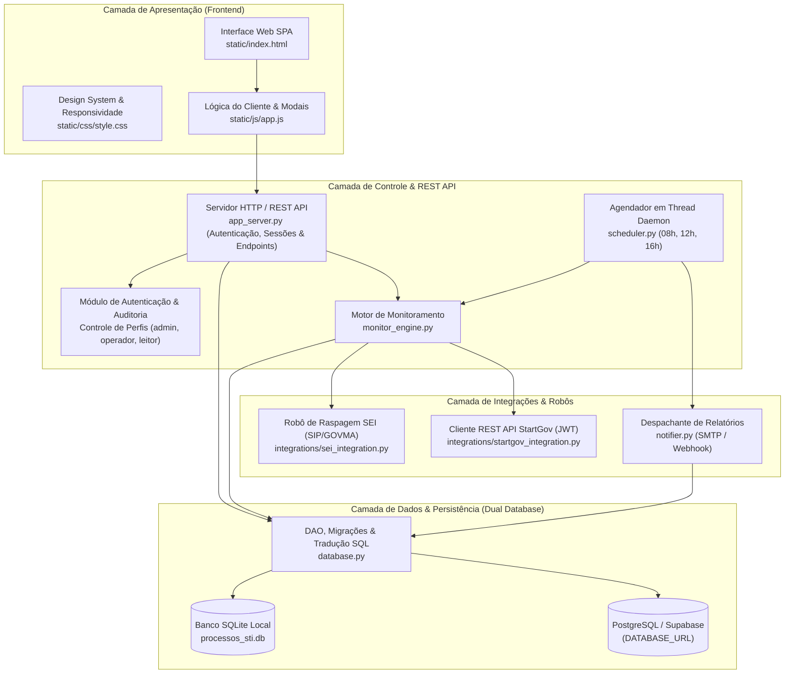

# Documentação Técnica e de Arquitetura de Desenvolvimento

**Sistema:** Sistema de Gestão e Monitoramento de Processos por Projeto - STI  
**Versão Atual:** v3.0 - Homologação  
**Data da Documentação:** Novembro/2026  
**Responsável Técnico:** Arquitetura de Software - STI / SEDUC-MA  

---

## 1. Visão Geral da Aplicação

O **Sistema de Gestão e Monitoramento de Processos por Projeto - STI** é uma solução corporativa concebida para a Superintendência de Tecnologia da Informação (STI) e extensível a todos os setores da **Secretaria de Estado da Educação do Maranhão (SEDUC-MA)**. 

O sistema tem como objetivo centralizar o controle de projetos estratégicos, governança multi-setorial por departamentos e automatizar o rastreamento contínuo de processos administrativos vinculados que tramitam em ecossistemas distintos:
* **SEI (Sistema Eletrônico de Informações - GOVMA)**: Tramitação de processos administrativos eletrônicos padrão do Governo Estadual.
* **STARTGOV (Portal de Gestão de Compras e Licitações)**: Tramitação de processos de contratação, cotação e termos de referência.

A aplicação opera com interface Web SPA moderna em JavaScript vanilla, servidor HTTP/REST integrado, suporte **Dual Database** (SQLite e PostgreSQL/Supabase) e agendador em background para envio programado de relatórios consolidados às **08:00, 12:00 e 16:00**.

---

## 2. Arquitetura de Software

A solução segue uma arquitetura modular em camadas desacopladas (**Layered Architecture**), com separação de responsabilidades e suporte tanto para desenvolvimento local quanto deploy escalável em nuvem.

### 2.1 Diagrama de Arquitetura do Sistema

---

## 3. Estrutura do Banco de Dados (Dual Database: SQLite & PostgreSQL)

O arquivo `database.py` suporta transparentemente SQLite (local) e PostgreSQL (Supabase/Neon/Render na nuvem). As migrações são executadas automaticamente na inicialização (`init_db()`), com criação de índices e integridade referencial.

### 3.1 Tabelas Principais

1. **`setores`**:
   - `id`: Chave primária.
   - `sigla`: Sigla única do setor (`STI`, `SAOFC`, `ASJUR`, `GAB`, `CPL`, `DA`, `SGP`, `SEDUC`).
   - `nome`: Nome por extenso do setor.
   - `ativo`: `1` para ativo, `0` para inativo.
   - `criado_em`: Data e hora de criação.

2. **`projetos`**:
   - `id`: Chave primária.
   - `nome`: Nome único do projeto (ex.: `DUARTE JR`, `ADESÃO CHROMEBOOK`).
   - `descricao`: Objeto e escopo compartilhado.
   - `etiqueta`: Classificação da demanda (`Contratos` ou `Pagamentos`).
   - `setor_sigla`: Sigla do setor responsável vinculado (padrão `STI`).
   - `criado_em`: Data de cadastro.

3. **`processos`**:
   - `id`: Chave primária.
   - `projeto_id`: Chave estrangeira referenciando `projetos(id)` com `ON DELETE CASCADE`.
   - `sistema`: Origem oficial (`SEI` ou `STARTGOV`).
   - `numero_processo`: Número oficial único do processo.
   - `local_atual`: Setor/unidade atual onde o processo se encontra.
   - `acao`: Providência ou ação imediata no último trâmite.
   - `data_recebimento`: Data de chegada na unidade atual (formato `DD/MM/AAAA`).
   - `situacao`: Descrição resumida do andamento atual.
   - `monitorar`: Indicador de monitoramento ativo (`1` ativo, `0` pausado).
   - `criado_em` / `atualizado_em`: Timestamps de auditoria.

4. **`historico_status`**:
   - `id`: Chave primária.
   - `processo_id`: Referência ao processo (`ON DELETE CASCADE`).
   - `data_registro`: Momento da coleta efetuada pelo robô.
   - `data_movimentacao`: Data oficial do trâmite (`DD/MM/AAAA HH:MM`).
   - `local`: Setor no momento do trâmite.
   - `situacao`: Andamento detalhado ou despacho.
   - `acao`: Tipo de ação registrada.
   - `observacao`: Detalhes adicionais / identificação de operador.

5. **`usuarios`**:
   - `id`: Chave primária.
   - `nome`: Nome completo do colaborador.
   - `usuario`: Login único (ex.: `admin`, `vicente`, `klelia`).
   - `senha_hash`: Hash seguro da senha (`PBKDF2-HMAC-SHA256`).
   - `perfil`: `admin` (visão geral e configurações), `operador` (gestão do seu setor) ou `leitor` (apenas consulta).
   - `setor_sigla`: Sigla do setor SEDUC ao qual o usuário está vinculado.
   - `ativo`: Indicador de conta ativa (`1` ou `0`).

6. **`configuracoes_sistema`**:
   - `chave` (PK): Chave de configuração (ex.: `email_enabled`, `smtp_server`, `smtp_port`, `smtp_user`, `smtp_pass`, `email_to`, `webhook_url`).
   - `valor`: Conteúdo configurado.
   - `atualizado_em`: Timestamp da última modificação.

7. **`auditoria_logs`**:
   - `id`: Chave primária.
   - `usuario`: Identificador do usuário que executou a ação.
   - `acao`: Código da operação (ex.: `LOGIN`, `CRIAR_PROJETO`, `ATUALIZAR_SETOR`, `CONFIG_DISPARO`).
   - `detalhes`: Descrição legível da operação.
   - `ip`: Endereço IP do cliente.
   - `criado_em`: Momento da operação.

8. **`relatorios_gerados`**:
   - Histórico de despachos e envios de e-mails/webhooks às 08h, 12h e 16h.

### 3.2 Índices Criados para Otimização
- `idx_projetos_setor` em `projetos(setor_sigla)`
- `idx_processos_projeto` em `processos(projeto_id)`
- `idx_historico_processo` em `historico_status(processo_id)`
- `idx_usuarios_setor` em `usuarios(setor_sigla)`
- `idx_auditoria_criado` em `auditoria_logs(criado_em)`

---

## 4. Endpoints da REST API (`app_server.py`)

| Método | Rota | Descrição | Permissão Mínima |
| :--- | :--- | :--- | :--- |
| `POST` | `/api/login` | Autenticação com geração de cookie de sessão | Público |
| `POST` | `/api/logout` | Encerramento de sessão | Autenticado |
| `GET` | `/api/usuario/atual` | Retorna dados do usuário logado e setor | Autenticado |
| `GET` | `/api/projetos` | Lista projetos filtrados pelo setor do usuário (ou todos se admin) | Autenticado |
| `POST` | `/api/projetos` | Criação de novo projeto com etiqueta e setor | Operador / Admin |
| `PUT` | `/api/projetos/<id>` | Edição de nome, descrição, etiqueta e setor | Operador / Admin |
| `DELETE` | `/api/projetos/<id>` | Exclusão de projeto e processos vinculados | Admin / Operador |
| `POST` | `/api/processos` | Cadastro simplificado de processo (SEI/StartGov) | Operador / Admin |
| `PUT` | `/api/processos/<id>` | Atualização cadastral de processo | Operador / Admin |
| `DELETE` | `/api/processos/<id>` | Exclusão de processo individual | Operador / Admin |
| `GET` | `/api/setores` | Lista os setores cadastrados da SEDUC | Autenticado |
| `POST` | `/api/setores` | Cadastro de novo setor da SEDUC | Admin |
| `PUT` | `/api/setores/<id>` | Atualização de sigla, nome ou status de setor | Admin |
| `GET` | `/api/usuarios` | Lista usuários cadastrados com respectivos setores | Admin |
| `POST` | `/api/usuarios` | Criação de novo usuário | Admin |
| `PUT` | `/api/usuarios/<id>` | Atualização de perfil, setor ou redefinição de senha | Admin |
| `GET` | `/api/configuracoes/canais` | Consulta configurações SMTP e Webhook | Admin |
| `POST` | `/api/configuracoes/canais` | Salva configurações de e-mail e webhook | Admin |
| `POST` | `/api/configuracoes/canais/testar`| Envio de e-mail/webhook de teste imediato | Admin |
| `GET` | `/api/sistemas` | Retorna status de credenciais SEI e StartGov | Autenticado |
| `POST` | `/api/sistemas/testar` | Executa teste de autenticação real nos portais | Admin |
| `GET` | `/api/auditoria` | Retorna trilha de auditoria com filtro e paginação | Admin |
| `POST` | `/api/sincronizar` | Executa sincronização manual dos portais via robôs | Operador / Admin |
| `POST` | `/api/disparar-resumo` | Executa disparo manual do resumo executivo | Operador / Admin |
| `GET` | `/api/relatorios/resumo` | Gera JSON do relatório consolidado com filtros | Autenticado |
| `GET` | `/api/relatorios/exportar` | Exportação de relatório em formato CSV/Excel | Autenticado |

---

## 5. Painel Administrativo Unificado (5 Pilares)

O modal administrativo (`#modalUsuarios`) centraliza todas as funcionalidades de governança em 5 abas horizontais:
1. **`👥 Cadastro & Gestão de Usuários`**: Formulário de criação/edição e tabela com filtro e badges de setor.
2. **`🏢 Setores da SEDUC`**: Cadastro e ativação de unidades administrativas.
3. **`📡 Canais de Disparo (E-mail & Webhook)`**: Parâmetros SMTP e mensageria com teste ao vivo.
4. **`🔑 Portais Oficiais & Robôs`**: Credenciais de órgãos e diagnóstico de autenticação com os servidores SEI e StartGov.
5. **`📜 Trilha de Auditoria`**: Histórico detalhado de ações administrativas e operacionais.
