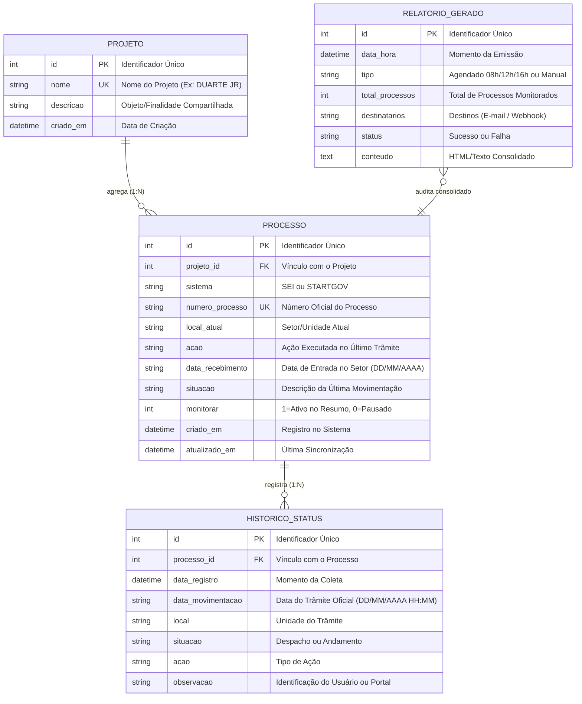
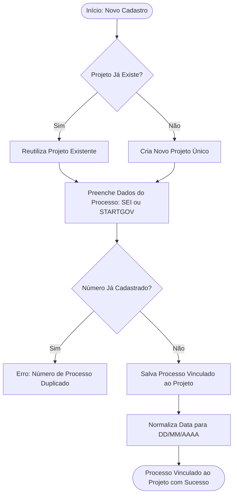
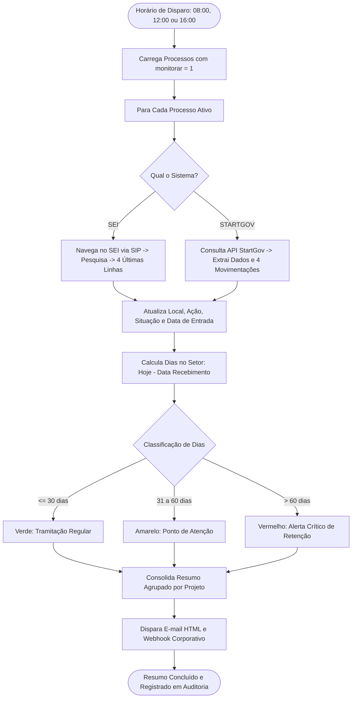

# Especificação de Regras de Negócio e Modelo Operacional

**Sistema:** Sistema de Gestão e Monitoramento de Processos por Projeto - STI  
**Versão Atual:** v2.0  
**Área de Negócio:** Superintendência de Tecnologia da Informação (STI)  
**Organização:** Secretaria de Estado da Educação do Maranhão (SEDUC-MA)  
**Papel:** Análise de Negócios e Governança de TI  

---

## 1. Visão de Negócio e Objetivos Estratégicos

### 1.1 Contexto e Justificativa
A Superintendência de Tecnologia da Informação (STI) da SEDUC-MA gerencia contratações, locações e aquisições complexas (ex.: equipamentos de informática, links de internet, licenças de software, suporte educacional). 

Historicamente, cada projeto estratégico necessita tramitar em múltiplos processos administrativos complementares e em plataformas governamentais distintas:
* **SEI (Sistema Eletrônico de Informações)**: Usado para tramitação de processos administrativos gerais, despachos jurídicos, pareceres da Assessoria Técnica (ASTEC) e deliberações de gabinete.
* **STARTGOV**: Usado na fase preparatória, licitatória e de cotações de preços (SUMES, CSL, etc.).

Antes da implantação deste sistema, o acompanhamento ocorria por planilhas manuais desconectadas, resultando em:
1. Perda de visibilidade sobre onde os processos estavam parados;
2. Dificuldade de relacionar múltiplos processos que pertencem a um mesmo projeto/contrato;
3. Atrasos operacionais graves por desconhecimento do tempo de retenção nos setores externos;
4. Falta de relatórios executivos diários nos horários de tomada de decisão.

### 1.2 Objetivo Principal
Prover uma plataforma unificada que vincule múltiplos processos a uma entidade **Projeto única**, monitore automaticamente seus andamentos em tempo real e forneça alertas de retenção para garantir agilidade nas contratações públicas de TI.

---

## 2. Modelo Conceitual de Dados

O modelo de negócio foi estruturado estritamente em torno da relação hierárquica **Projeto (Pai) -> Processos (Filhos) -> Histórico de Status (Linha do Tempo)**.

---

## 3. Mapeamento dos Fluxos de Valor do Negócio

### 3.1 Fluxo de Cadastro e Agregação de Projetos

### 3.2 Fluxo de Ciclo de Monitoramento e Alertas

---

## 4. Catálogo Detalhado de Regras de Negócio (RN)

### RN-01: Unicidade do Projeto e Compartilhamento de Objeto
* **Descrição**: O Projeto é a entidade agregadora máxima. Não deve haver duplicação de nomes de projetos no sistema.
* **Validação**: Se o usuário cadastrar um processo com um nome de projeto já existente (ex.: `DUARTE JR`), o sistema **obrigatoriamente reutiliza o projeto existente**, vinculando o novo processo a ele e herdando/mantendo a descrição/objeto contratual.
* **Critério de Aceite**: A tabela visual não exibe linhas repetidas para o mesmo projeto; ela consolida as células com o nome do projeto mesclado verticalmente e os processos subordinados.

### RN-02: Cardinalidade e Vinculação de Múltiplos Processos (1:N)
* **Descrição**: Um mesmo Projeto pode conter múltiplos processos vinculados, sem limite preestabelecido.
* **Cenário Real**: Um projeto pode conter 2 processos do SEI (ex.: processo de pagamento e processo do termo de referência) e 1 processo do STARTGOV (cotação de compras).
* **Exclusão em Cascata**: A exclusão de um projeto acarreta a exclusão de todos os processos e históricos vinculados a ele. A exclusão de um processo individual não afeta o projeto nem os demais processos irmãos.

### RN-03: Compatibilidade de Sistemas Administrativos
* **Descrição**: O sistema suporta nativamente duas origens de dados:
  1. **SEI**: Processos eletrônicos da Administração Direta do Maranhão.
  2. **STARTGOV**: Processos de compras e licitações.
* **Validação**: O campo `sistema` é obrigatório e restrito aos valores pré-definidos (`SEI` ou `STARTGOV`).

### RN-04: Cálculo Oficial de Prazos ("Dias no Setor")
* **Descrição**: Mede o tempo decorrido desde a chegada do processo à unidade atual até o dia de hoje.
* **Fórmula de Negócio**:
  $$\text{Dias no Setor} = \max\left(0, \text{Data Atual} - \text{Data de Recebimento}\right)$$
* **Regra de Apuração**:
  - Apenas as datas em si são computadas (dias corridos inteiros).
  - Se a data de recebimento não for informada ou for futura, o valor é nulo (`-`) ou zero.

### RN-05: Classificação de Criticidade e Indicadores de Alerta Visual
* **Descrição**: Classifica o processo de acordo com o tempo de permanência no mesmo setor para subsidiar cobranças da chefia da STI.
* **Faixas de Criticidade**:
  | Faixa de Dias | Classificação | Cor na GUI / E-mail | Ação Recomendada |
  | :--- | :--- | :--- | :--- |
  | **0 a 30 dias** | Regular / Normal | Verde (`#10b981`) | Tramitação dentro do fluxo esperado. |
  | **31 a 60 dias** | Atenção | Amarelo / Âmbar (`#f59e0b`) | Solicitar prioridade à unidade responsável. |
  | **Acima de 60 dias** | **Alerta Crítico** | **Vermelho (`#ef4444`)** | Notificar gestores imediatamente (gargalo crítico). |

### RN-06: Regra dos 4 Últimos Status (Linha do Tempo Recente)
* **Descrição**: Para evitar sobrecarga de informação nos relatórios executivos, o sistema restringe o histórico a **exatamente as 4 movimentações mais recentes**.
* **Ordenação**:
  - Ordem cronológica decrescente rigorosa (da mais nova para a mais antiga).
  - **Linha 1**: Movimentação mais recente (identificada visualmente como `Posição Atual`).
  - **Linhas 2, 3 e 4**: Movimentações anteriores imediatas.
* **Conteúdo Mínimo Obrigatório**: Data/Hora da movimentação (`DD/MM/AAAA HH:MM`), Unidade/Setor, Descrição/Despacho e Identificação do Usuário/Portal.

### RN-07: Padrão Oficial de Datas (DD/MM/AAAA)
* **Descrição**: Todas as datas apresentadas ou exportadas pelo sistema devem aderir estritamente ao formato brasileiro oficial: **dia/mês/ano** (`DD/MM/AAAA`) e **dia/mês/ano hora:minuto** (`DD/MM/AAAA HH:MM`).
* **Tratamento de Entrada**: Se o usuário ou robô fornecer datas em formato ISO (`AAAA-MM-DD`), o sistema deve convertê-las automaticamente antes de persistir e renderizar.
* **Exceções**: Em caso de data vazia ou não preenchida, o sistema deve apresentar `-` de forma amigável.

### RN-08: Ciclo Triplo de Notificação (08h, 12h e 16h)
* **Descrição**: Os resumos executivos devem ser gerados e despachados pontualmente nos horários de tomada de decisão:
  - **08:00**: Abertura do expediente (planejamento das cobranças do dia).
  - **12:00**: Fechamento do turno matutino (acompanhamento de andamentos da manhã).
  - **16:00**: Fechamento do expediente vespertino (balanço de fim de dia).
* **Condição de Disparo**: O agendador só executa uma vez por hora cheia (evitando disparos duplicados).

### RN-09: Segregação de Monitoramento Ativo (`monitorar = 1`)
* **Descrição**: Processos podem ser desativados do monitoramento automático sem serem excluídos do histórico do projeto.
* **Comportamento**:
  - `monitorar = 1`: O processo é consultado nos portais pelos robôs e figura nos e-mails e relatórios diários.
  - `monitorar = 0`: O processo fica arquivado/pausado para consultas e emissão de resumos, mas permanece visível na tela quando o filtro `"Todos os Processos"` estiver ativo.

### RN-10: Tratamento de Exceções de Negócio & Contingência nos Portais
* **Descrição**: Caso o SEI ou STARTGOV apresentem instabilidade, timeout ou captcha:
  1. O sistema **não aborta** a rotina geral de monitoramento.
  2. Mantém os dados da última posição conhecida com sucesso.
  3. Registra na barra de status e nos logs o motivo da falha transitória (ex.: `"Falha ao consultar: Timeout de conexão"`).
  4. O próximo ciclo agendado tentará a consulta novamente de forma autônoma.

### RN-11: Deep-Linking e Agilidade Operacional via Área de Transferência (v2.0)
* **Descrição**: O analista deve conseguir saltar diretamente da tela de gestão para os autos oficiais no portal de origem.
* **Regras de Interação**:
  - **Clique com Botão Esquerdo no Nº do Processo**:
    1. O número é copiado imediatamente para a Área de Transferência do sistema operacional (`Clipboard`).
    2. O navegador padrão é aberto diretamente no portal oficial do processo.
    3. Para processos do StartGov, a busca é preenchida automaticamente via URL.
    4. Para processos do SEI, a tela de controle/login é aberta, permitindo que o usuário dê `Ctrl + V` imediatamente.
  - **Clique com Botão Direito no Nº do Processo**:
    - Abre menu de contexto com opções de cópia simples, abertura de consulta pública ou detalhamento do histórico interno.

---

## 5. Matriz de Rastreabilidade: Regra de Negócio vs. Implementação Técnica

| Regra de Negócio | Módulo Técnico Responsável | Componente / Função Principal |
| :--- | :--- | :--- |
| **RN-01 (Unicidade de Projeto)** | `database.py` | `obter_ou_criar_projeto()` |
| **RN-02 (Relação 1:N & Cascata)** | `database.py` | `CREATE TABLE processos ... ON DELETE CASCADE` |
| **RN-03 (SEI / STARTGOV)** | `integrations/` | `sei_integration.py` e `startgov_integration.py` |
| **RN-04 (Dias no Setor)** | `database.py` | `calcular_dias_no_setor()` |
| **RN-05 (Criticidade e Cores)** | `app_gui.py` / `notifier.py` | Lógica de badge de criticidade (`>60 dias = Vermelho`) |
| **RN-06 (4 Últimos Status)** | `database.py` | `salvar_historico_4_status()` com `ORDER BY id DESC LIMIT 4` |
| **RN-07 (Datas DD/MM/AAAA)** | `database.py` | `formatar_data_br()` e `formatar_data_hora_br()` |
| **RN-08 (Horários 08h, 12h, 16h)** | `scheduler.py` | `RelatorioScheduler._run_loop()` |
| **RN-09 (Filtro de Monitoramento)**| `app_gui.py` / `database.py` | Query com parâmetro `apenas_monitorados=True` |
| **RN-10 (Resiliência a Falhas)** | `monitor_engine.py` | Bloco `try/except` individualizado por processo |
| **RN-11 (Deep-Link e Clipboard)** | `app_gui.py` / `static/js/app.js` | `abrir_processo_direto()` e `clipboard_append` |
