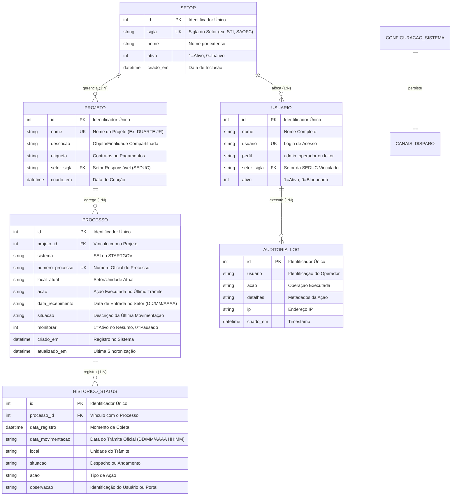

# Especificação de Regras de Negócio e Modelo Operacional

**Sistema:** Sistema de Gestão e Monitoramento de Processos por Projeto - STI  
**Versão Atual:** v3.0 - Homologação  
**Área de Negócio:** Superintendência de Tecnologia da Informação (STI) & Setores da SEDUC  
**Organização:** Secretaria de Estado da Educação do Maranhão (SEDUC-MA)  
**Papel:** Análise de Negócios e Governança Corporativa  

---

## 1. Visão de Negócio e Objetivos Estratégicos

### 1.1 Contexto e Justificativa
A Superintendência de Tecnologia da Informação (STI) e as demais secretarias adjuntas da SEDUC-MA gerenciam contratações, pagamentos, cotações e aquisições complexas (ex.: equipamentos de informática, links de fibra óptica, conectividade de escolas, licenças educacionais, materiais didáticos e infraestrutura escolar). 

Historicamente, cada demanda estratégica tramita em múltiplos processos administrativos complementares e em plataformas governamentais distintas:
* **SEI (Sistema Eletrônico de Informações)**: Usado para tramitação de processos administrativos gerais, termos de referência, despachos jurídicos (ASJUR), pareceres orçamentários (SAOFC) e deliberações de gabinete (GAB).
* **STARTGOV**: Usado na fase preparatória, licitatória e de cotações de preços (SUMES, CPL, etc.).

Com a evolução para a **Versão 3.0**, o sistema passa a atender de forma federada todos os **Setores da SEDUC**, garantindo que equipes setoriais monitorem os seus respectivos processos de interesse com isolamento e segurança, enquanto o perfil **Administrador** possui visão panorâmica e integrada de todas as iniciativas da pasta.

### 1.2 Objetivos Principais
1. Prover uma plataforma unificada que vincule múltiplos processos a uma entidade **Projeto única** com classificação por setor e etiqueta de demanda (`Contratos` ou `Pagamentos`).
2. Eliminar o trabalho manual de preenchimento de campos redundantes de trâmites (local, data, situação), delegando a coleta integralmente aos robôs de automação do SEI e StartGov.
3. Disponibilizar governança multi-setorial com controle de acessos por perfil (`admin`, `operador`, `leitor`).
4. Centralizar a gestão de canais de disparo, portais e auditoria em um único painel administrativo.
5. Manter alertas preventivos de retenção de processos e resumos executivos diários nos horários de tomada de decisão (08h, 12h e 16h).

---

## 2. Modelo Conceitual de Dados

O modelo de negócio estrutura-se em torno de 5 entidades centrais com relacionamentos relacionais e integridade referencial:

---

## 3. Catálogo Detalhado de Regras de Negócio (RN)

### RN-01: Unicidade do Projeto e Compartilhamento de Objeto
* **Descrição**: O Projeto é a entidade agregadora máxima. Não deve haver duplicação de nomes de projetos no sistema.
* **Validação**: Se o usuário tentar cadastrar um processo com o nome de um projeto já existente, o sistema reutiliza o projeto existente, vinculando o novo processo a ele e preservando descrição, setor e etiqueta.

### RN-02: Cardinalidade e Vinculação de Múltiplos Processos (1:N)
* **Descrição**: Um mesmo Projeto pode conter múltiplos processos vinculados (SEI e/ou StartGov).
* **Exclusão em Cascata**: A exclusão de um projeto acarreta a exclusão em cascata de todos os processos e históricos subordinados. A exclusão de um processo individual não afeta o projeto nem processos irmãos.

### RN-03: Compatibilidade de Sistemas Administrativos
* **Descrição**: O sistema suporta nativamente duas origens de dados:
  1. **SEI**: Processos eletrônicos da Administração Direta do Maranhão.
  2. **STARTGOV**: Processos de compras e licitações.

### RN-04: Cálculo Oficial de Prazos ("Dias no Setor")
* **Descrição**: Mede o tempo decorrido desde a data de entrada do processo na unidade atual até o dia de hoje.
* **Fórmula de Negócio**:
  $$\text{Dias no Setor} = \max\left(0, \text{Data Atual} - \text{Data de Recebimento}\right)$$

### RN-05: Classificação de Criticidade e Indicadores de Alerta Visual
* **Faixas de Criticidade**:
  | Faixa de Dias | Classificação | Cor na UI / E-mail | Ação Recomendada |
  | :--- | :--- | :--- | :--- |
  | **0 a 30 dias** | Regular / Normal | Verde (`#10b981`) | Tramitação regular esperada. |
  | **31 a 60 dias** | Atenção | Amarelo (`#f59e0b`) | Solicitar prioridade à unidade responsável. |
  | **Acima de 60 dias** | **Alerta Crítico** | **Vermelho (`#ef4444`)** | Notificar gestores imediatamente (gargalo). |

### RN-06: Regra dos 4 Últimos Status (Linha do Tempo Recente)
* **Descrição**: Para evitar sobrecarga de informação nos relatórios executivos, o sistema restringe o histórico a **exatamente as 4 movimentações mais recentes** em ordem cronológica decrescente.

### RN-07: Padrão Oficial de Datas (DD/MM/AAAA)
* **Descrição**: Todas as datas apresentadas ou exportadas pelo sistema devem aderir rigorosamente ao formato brasileiro: **dia/mês/ano** (`DD/MM/AAAA`) e **dia/mês/ano hora:minuto** (`DD/MM/AAAA HH:MM`).

### RN-08: Ciclo Triplo de Notificação (08h, 12h e 16h)
* **Descrição**: Os resumos executivos são gerados e despachados pontualmente nos horários de tomada de decisão:
  - **08:00**: Início do expediente (planejamento das cobranças matutinas).
  - **12:00**: Fechamento do turno matutino.
  - **16:00**: Fechamento do expediente vespertino.

### RN-09: Segregação de Monitoramento Ativo (`monitorar = 1`)
* **Descrição**: Processos podem ser desativados temporariamente do monitoramento sem exclusão de dados (`monitorar = 0`). Processos pausados não são consultados pelos robôs nem entram nos resumos disparados.

### RN-10: Tratamento de Exceções & Resiliência nos Portais
* **Descrição**: Caso o SEI ou STARTGOV apresentem instabilidade, o sistema não aborta o monitoramento geral. Ele preserva os dados da última posição conhecida com sucesso e registra a advertência para tentativa no próximo ciclo.

### RN-11: Deep-Linking e Agilidade Operacional via Área de Transferência
* **Descrição**: Clicar sobre o número do processo abre o portal oficial no navegador padrão e copia automaticamente o número oficial para a Área de Transferência (`Clipboard`), agilizando consultas.

### RN-12: Governança Multi-Setorial e Perfil de Visualização (v3.0)
* **Descrição**: Projetos são obrigatoriamente vinculados a um setor da SEDUC (`STI`, `SAOFC`, `ASJUR`, `GAB`, `CPL`, etc.).
* **Regras de Visualização**:
  1. Usuários com perfil **`operador`** ou **`leitor`** visualizam apenas os projetos pertencentes ao seu setor de cadastro.
  2. Usuários com perfil **`admin`** têm acesso corporativo unificado e visualizam todos os projetos de todos os setores da SEDUC.
* **Segurança**: Tentativas de acesso ou manipulação de projetos de outros setores por usuários não administradores são rejeitadas com código HTTP `403 Forbidden`.

### RN-13: Categorização por Etiqueta de Projeto (v3.0)
* **Descrição**: Todo projeto deve possuir uma etiqueta que tipifica a natureza de sua execução:
  - **`1 - Contratos`**: Demandas de fornecimento contínuo, licitações, termos de parceria ou locação de bens e serviços.
  - **`2 - Pagamentos`**: Processos de liquidação de despesa, atesto de notas fiscais e empenho.
* **Aplicação**: A etiqueta é exibida em badges distintas na grid principal, filtros da barra superior e em todos os relatórios gerados pelo sistema.

### RN-14: Cadastro Simplificado e Captação Automatizada de Metadados (v3.0)
* **Descrição**: Na tela de inclusão de novos processos, é dispensado o preenchimento manual dos campos *Local/Setor Atual*, *Data de Recebimento*, *Situação* e *Ação Imediata*.
* **Comportamento do Robô**:
  1. O usuário informa apenas o Projeto e o número do processo (**SEI** e/ou **STARTGOV**).
  2. O sistema aciona os conectores dos portais oficiais, captura imediatamente a tramitação atual e preenche os metadados diretamente no banco de dados.

### RN-15: Gestão Administrativa Centralizada e Trilha de Auditoria (v3.0)
* **Descrição**: A administração do sistema é centralizada no Painel Administrativo estruturado em 5 pilares:
  1. *Cadastro e Gestão de Usuários*;
  2. *Setores da SEDUC*;
  3. *Canais de Disparo (E-mail SMTP & Webhook)*;
  4. *Portais Oficiais & Robôs*;
  5. *Trilha de Auditoria*.
* **Imutabilidade**: Toda ação de criação, alteração ou exclusão de dados administrativos é registrada na tabela `auditoria_logs` com usuário, ação, detalhes, IP e data/hora.

### RN-16: Configuração Dinâmica dos Canais de Disparo (v3.0)
* **Descrição**: As configurações de envio de relatórios (servidor SMTP, porta, credenciais, e-mails de destino e webhook) podem ser mantidas diretamente pela interface gráfica, persistidas no banco (`configuracoes_sistema`) com prioridade sobre as variáveis do arquivo `.env` e testadas em tempo real com o botão *Testar Disparo*.
